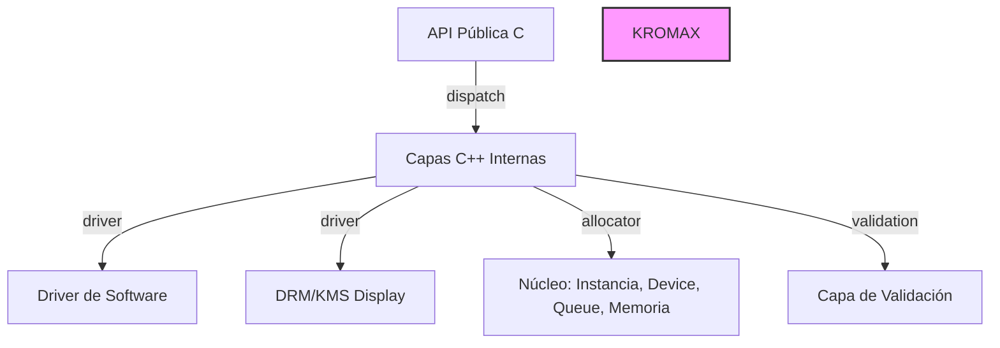

# Doc

## Propósito
Documentación del proyecto.

## Contenido
- API documentation
- Guías de usuario
- Tutoriales

## Estructura de Documentación

### carpetas requeridas
Crear la siguiente estructura en la carpeta `doc/` del proyecto:

```
doc/
├── <ProjectStructure>.md    # Estructura del proyecto
├── <ManualUso>.md          # Manual de uso
└── <BugsTecnicos>.md       # Bugs técnicos
```

### Instrucción para generar documentos en formato `<idioma>.md`

Al crear documentos de documentación técnica, seguir este patrón:

```
doc/
├── ProjectStructure.es.md   # Estructura del proyecto (español)
├── ProjectStructure.eng.md  # Structure (English)
├── ManualUso.es.md          # Manual de uso (español)
├── ManualUso.eng.md         # User Manual (English)
├── BugsTecnicos.es.md       # Bugs técnicos (español)
└── BugsTecnicos.eng.md      # Technical Bugs (English)
```

### Bugs Técnicos

**Propósito**: Documentar bugs cuyo origen no es un error lógico del código, sino una **limitación, comportamiento no obvio o latencia de una herramienta externa** (filesystem, compilador, API gráfica, dependencia, SO, etc.).

Sirve para que agentes (y humanos) reconozcan el patrón, apliquen la mitigación conocida y eviten re-investigar lo ya resuelto.

#### Formato recomendado para BugsTecnicos.md:

```
# Bugs Técnicos - <ProjectName>

## [ID Bug] Descripción breve del bug

### Propósito
Descripción del bug técnico, limitación o comportamiento no obroso.

### Herramienta/Afectada
- filesystem
- compilador
- API gráfica
- dependencia
- SO

### Síntomas
- Comportamiento observado
- Condiciones de reproducción

### Mitigación
- Workaround conocido
- Configuración alternativa
- Versión mínima requerida

### Referencias
- Enlaces a documentación
- Commit history
- Issues relacionados
```

## Ejemplo de Diagrama de Arquitectura (Mermaid)

Para documentar la arquitectura del proyecto, se pueden usar diagramas Mermaid. Ejemplo incluido en ARQUITECTURA.md:



## Documentación Pura en UML

Para documentación de arquitectura de nivel superior o requerimientos formales, mantener documentación pura en UML como estándar complementario:

### Diagramas UML recomendados:

- **Diagrama de Clases** - Estructura de tipos de datos y relaciones
- **Diagrama de Composición** - Jerarquía de módulos y sub-sistemas
- **Diagrama de Secuencia** - Interacciones entre componentes en tiempo de ejecución
- **Diagrama de Componentes** - Dependencias entre librerías y módulos

### Formato de archivo:

Guardar documentación UML en la carpeta `doc/` con sufijo `.uml.md`:

```
doc/
├── ArquitecturaUML.es.md    # Arquitectura en UML (español)
├── ArquitecturaUML.eng.md   # Architecture UML (English)
├── DiagramaClases.es.md     # Class Diagram (español)
└── DiagramaClases.eng.md    # Class Diagram (English)
```


### Herramientas recomendadas:

- **PlantUML** - Generación y renderizado de diagramas UML
- **Mermaid** - Para diagramas simples directamente en Markdown
- **Draw.io / Diagrammer** - Herramientas gráficas para diagramas complejos

### Integración con el flujo de trabajo:

1. Crear diagramas UML para visión arquitectónica global
2. Usar Mermaid para documentación técnica detallada y rápida
3. Mantener sincronizados ambos formatos cuando sea necesario
4. Versionar diagramas junto con el código fuente
