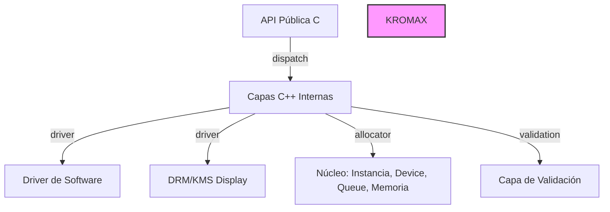

# Skills: Readme.md Template & Guidelines

## Propósito de esta Plantilla
Este archivo `Skills/readme.md` no es un README.md de proyecto específico. Es una **guía de patrones y estructura** que sirve para que cualquier IA (o desarrollador) genere un `README.md` profesional y completo para cualquier repositorio C++ que siga la arquitectura definida.

### Estructura Obligatoria para Cualquier README.md
Todo proyecto debe incluir estas secciones (en este orden). Cada sección indica:
- **Qué información poner**
- **Dónde poner la información específica del proyecto**
- **Formato recomendado**

### 2. Requisitos del Sistema

#### 2.1 Sistema operativo
- **Linux** (probado en Ubuntu 22.04/24.04, Debian 12, u otra distro)
- **Windows** (via MSVC + vcpkg, MinGW, u otra herramienta)
- **macOS** (estado experimental o compatible)

**Qué rellenar:**
- Listar SO soportados con versiones probadas
- Marcar cuáles son "experimentales"

#### 2.2 Dependencias de sistema (Linux ejemplo)
```bash
sudo apt-get update && sudo apt-get install -y \
  libglfw3-dev \
  libgl1-mesa-dev \
  libglu1-mesa-dev \
  libglm-dev \
  libassimp-dev \
  ... (otras dependencias)
```


**Qué rellenar:**
- Lista de librerías específicas del proyecto
- Incluir: GUI (GLFW, SDL), GUI ImGui, modelos (Assimp), matemáticas (GLM), etc.
- Para Windows/macOS, proporcionar equivalencias o marcar como "opcional"

#### 2.3 Opcionales
- **JDK 17+** — requerido para soporte Java/JNI
- **CEF** — requerido para interfaces web (backend CEF)
- **Otras dependencias** específicas del proyecto

### 3. Instalación y Compilación
```
# 1. Clonar el repositorio
git clone <URL del repositorio>
cd <NombreDelProyecto>

# 2. Configurar (Release, ASAN off, Java on)
cmake -B build -S . -G Ninja \
  -DCMAKE_BUILD_TYPE=Release \
  -DENABLE_ASAN=OFF \
  -DFUNSHI_JAVA=ON

# 3. Compilar
cmake --build build -j$(nproc)
```

**Qué rellenar:**
- URL del repositorio git
- Directorio donde está el CMakeLists.txt principal
- Opciones CMake específicas del proyecto
- Comando de compilación final


### 6. Pruebas

# Ejecutar todas las pruebas
cd <DirectorioDelMotor>/build && ctest --output-on-failure -j$(nproc)

# Ejecutar una suite concreta
./<Suite1>-tests
./<Suite2>-tests

- Usar `ctest` para ejecutar todas
- Ejemplos de suites específicas
- Mención de CI (GitHub Actions, plataformas)

**Qué rellenar:**
- Comando ctest o equivalente
- Suties de pruebas importantes
- Información sobre CI/CD

### 8. Documentación Relacionada

```
doc/
├── <ProjectStructure>.md    # Estructura del proyecto
├── <ManualUso>.md          # Manual de uso
└── <BugsTecnicos>.md       # Bugs técnicos
```

### 9. Licencia
```
**Copyright <Year> <Autor/Empresa>**

El código propio del motor se distribuye bajo la <Licencia> (ver [LICENSE](LICENSE) y [NOTICE](NOTICE)).

Las bibliotecas de terceros integradas (Dear ImGui, ImGuizmo, nlohmann/json, stb_image, GLM) conservan sus licencias originales —principalmente MIT— y **no están cubiertas por la <Licencia principal>**. Consulta [THIRD_PARTY_NOTICES.md](THIRD_PARTY_NOTICES.md) para el detalle completo.
```

### Diagrama de Arquitectura (Mermaid)

- Año de copyright
- Nombre del autor/empresa
- Licencia principal (Apache 2.0)
- Excepción para librerías de terceros (MIT)
- Archivo de notices tercero

**Qué rellenar:**
- Año actual o rango de años
- Nombre del autor o empresa
- Licencia usada en el proyecto
- Librerías de terceros incluidas y sus licencias
- Adaptar descripción al dominio del proyecto
- Incluir diagrama Mermaid si tiene arquitectura compleja
