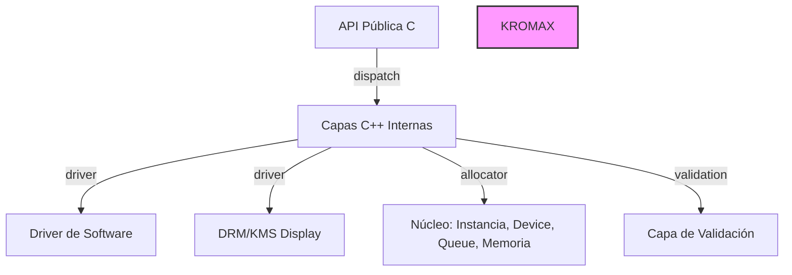

# Instrucciones generales

## Estructura de Archivos Locales (.local)

La carpeta `.local/` es ignorada por git mediante `.gitignore`. Contiene toda la información y herramientas que utiliza el agente para trabajar en este repositorio.

### `.local/Skills/`
Contiene toda la información que necesita el agente sobre cómo trabajar en este repositorio. Aquí se almacenan:
- Documentación sobre convenciones de código
- Guías de arquitectura
- Información sobre patrones utilizados en el proyecto
- Documentación de templates disponibles
- Procedimientos para realizar contribuciones

### `.local/.agentes/`
Contiene toda la información referente a la gestión y seguimiento del trabajo del agente.

Archivo preparativo:

El repositorio solo debe contener lo minimo e indespensable.
Se recomienda trabajar con clang y c++ 17 como estandar.
Todo el contenido adicional (test,dependencias,skills,documentaciones de tareas o planes,.env,etc) debe ir en .local

Usa los .gitignore, .gitattributes, .github .editorconfig

.github/(
Templates/<TIPO>_TEMPLATE.md
ej:Templates/COMMITS/<features>_TEMPLATE.md, Templates/COMMITS/<fixes>_TEMPLATE.md, Templates/COMMITS/<refactors>_TEMPLATE.md, Templates/COMMITS/<docs>_TEMPLATE.md, etc
scripts 
workflows
)

.local/
agents.md
tests
CMakeLists.txt (tests y otros)
build

Skills/(
(Como trabajar)
no colocar en las Skills emojis

1. **arq.md**
- Propósito: Plantilla genérica de convenciones de arquitectura para proyectos C++. Define directrices de módulos, patrones de diseño, nomenclatura, y documentación. Incluye badas prácticas y ejemplo de uso.
2. **code.md**
- Propósito: Convenciones de código y estilo para C++. Incluye sanitizador de comentarios (prohibido emojis, solo ASCII), nombres PascalCase/camelCase, estructura de copyright, y flujo de trabajo integrado con todas las skills.
3. **fix.md**
- Propósito: Guía formal de corrección de bugs. Fases: identificación → análisis de causa → desarrollo del fix → validación final. Incluye procedimiento ante ambigüedades y patrones de prevención de errores.
4. **git.md**
- Propósito: Flujo de trabajo Git completo. Define 3 ramas permanentes (master, test, develop), convenciones de ramas temporales, flujo de pull requests, y reglas de sincronización para equipos.
5. **issues.md**
- Propósito: Guía de manejo de issues. Tipos soportados (bug, feature, documentation, build/CI, performance, question, area), etiquetas recomendadas, y flujo de resolución desde creación hasta cierre.
6. **license.md**
- Propósito: Guía para licencias del proyecto. Estructura de licencias raíz (LICENSE, NOTICE), licencias en .local/, y buenas prácticas para mantener THIRD_PARTY_NOTICES.md actualizada.
7. **log.md**
- Propósito: Sistema obligatorio de logs .txt para builds y tareas largas. Formato con timestamps UTC, configuración CMake, progreso y duración. Política: nunca editar logs posteriores, solo append new entries.
8. **memory.md**
- Propósito: Sistema para que agentes organicen memoria de trabajo usando .local/.agentes/. Incluye sintaxis por tareas (plan.md, progress.md append-only, commits mentales) y por branches (estado-branch.md, cambio de branch). Comandos rápidos para gestionar memoria.
9. **readme.md**
- Propósito: Plantilla genérica para generar README.md en cualquier repositorio C++. Usa placeholders en lugar de valores específicos, incluye secciones de propósito, requisitos, instalación, CMake options, tests, licencia, y API gráfica.
10. **refactor.md**
- Propósito: Guía de refactorización de código. Fases: análisis previo → checklist → proceso de trabajo → validación post-refactor. Includes checklist de validación y riesgos comunes con prevenciones.
11. **repo.md**
- Propósito: Comandos esenciales plataforma-independent. Configuración CMake, build, tests, ejecutables, flags por plataforma (Linux/Windows/cross-compilation), y convenciones de build diario vs CI.
12. **test.md**
- Propósito: Estructura y ejecución de tests en C++. Organización de tests (unitarios, integración, headless), ejecución con ctest, convenciones de nombres, y definición en CMakeLists.txt.
13. **ci.md**
- Propósito: Configuración CI/CD genérica. Ejemplos GitHub Actions y GitLab CI, comandos de prueba recomendados, cobertura de tests headless, y badges recomendados. Integración con otras skills.
14. **doc.md**
- Propósito: Guía de documentación del proyecto. Estructura de carpetas doc/, formato de documentos <idioma>.md, bugs técnicos, diagramas Mermaid y UML, e integración con flujo de trabajo.
15. **feat.md**
- Propósito: Guía para nuevas funcionalidades. Estructura obligatoria: propuesta → checklist de implementación → criterios de aceptación → proceso de trabajo. Incluye integración con .local/agentes/ y skills relacionadas.
16. **build.md**
- Propósito: Comandos de build y configuración CMake. Build types (Debug/Release/híbrido), flags importantes, generadores, flujo de trabajo completo, y diferenciación build diario vs CI/CD.
)

.agentes/(
(Informacion para trabajar)

PLAN-FIX/<TIPO_DE_PLAN>.md
PLAN-FEAT/<TIPO_DE_PLAN>.md
PLAN-REFACTOR/<TIPO_DE_PLAN>.md
PLAN-DOC/<TIPO_DE_PLAN>.md

MEMORY-FIX/<TIPO_DE_PLAN>.md
MEMORY-FEAT/<TIPO_DE_PLAN>.md
MEMORY-REFACTOR/<TIPO_DE_PLAN>.md
MEMORY-DOC/<TIPO_DE_PLAN>.md
)

### Diagrama de Arquitectura (Mermaid)
EJ:

